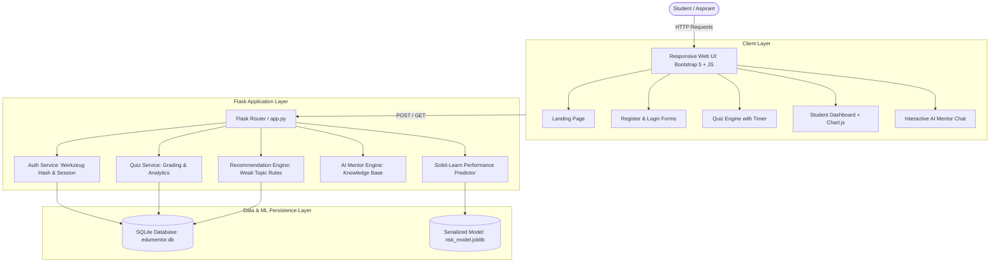
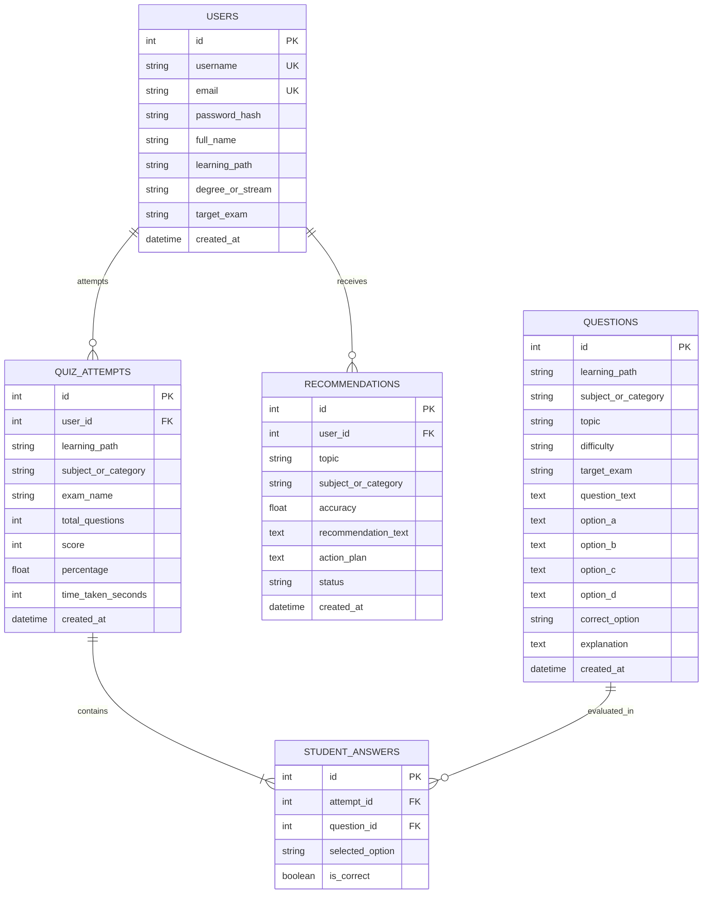

# EduMentor AI: Technical Project Report & Viva Handbook

**Project Title:** EduMentor AI: An AI-Powered Personalized Learning and Competitive Exam Preparation System  
**Sustainable Development Goal Alignment:** UN SDG 4 — Quality Education  
**Technology Stack:** Python Flask 3.1, SQLite, Flask-SQLAlchemy, Scikit-Learn, Pandas, NumPy, HTML5, CSS3, JavaScript, Bootstrap 5.3, Chart.js, pytest  
**Environment:** Local Windows Environment, Zero Paid API Dependency  

---

## 1. Executive Summary & Abstract

Traditional education and competitive examination preparation platforms often suffer from two major flaws: either they overwhelm students with non-targeted, static question banks without performance diagnostics, or they gate personalized tutoring behind costly subscription fees and paid AI API paywalls.

**EduMentor AI** is an autonomous educational web application designed to democratize high-quality, personalized learning for college students and competitive exam aspirants. Developed with strict alignment to **United Nations Sustainable Development Goal 4 (Quality Education)**, the system features:
1. **Dual Learning Pathways**:
   - **Path A (College Learning)**: Computer Science semester curricula (Python Programming, Data Structures, DBMS).
   - **Path B (Competitive Exam Preparation)**: Shared recruitment exam test categories (Quantitative Aptitude, Logical Reasoning, English Language, General Awareness) mapped across SSC, Banking, Railway, UPSC, and State PSCs.
2. **Calibrated Quiz Engine**: Real-time scoring, countdown timers for competitive mock tests, and comprehensive answer explanations.
3. **Personalized Recommendation Engine**: Rule-based analytics detecting weak topics (&lt;60% accuracy) and generating targeted study roadmaps.
4. **Predictive Machine Learning Module**: Scikit-Learn classification pipeline predicting student performance risks with clear baseline comparisons.
5. **Autonomous AI Mentor Agent**: Fully offline, zero-cost knowledge base answering student queries and explaining tricky concepts using simple mental models.

---

## 2. System Architecture & Data Flow

---

## 3. Database Entity-Relationship (ER) Model

---

## 4. Machine Learning Module & Evaluation Report

### 4.1 Objective & Feature Selection
The ML pipeline predicts student risk of underperforming (`needs_intervention = 1` if projected to struggle or score &lt;65%, `0` if proficient / on track).

**Input Features:**
1. `avg_score_past`: Historical quiz average (float, 0-100%)
2. `quizzes_attempted`: Cumulative practice volume (integer)
3. `time_per_question`: Pacing in seconds (float, 10-120s)
4. `difficulty_level`: Weight index (1=Easy, 2=Medium, 3=Hard)
5. `consistency_score`: Habitual study cadence (integer, 1-10)

### 4.2 Data Integrity & Leakage Prevention
- Demonstrative synthetic benchmark dataset generated with fixed random seeds (`random_seed=42`, $N=600$).
- Clean **75% / 25% stratified train/test split**. Feature scaling (`StandardScaler`) is fitted strictly on the training partition and transformed on test data within a Scikit-Learn `Pipeline` to eliminate data leakage.

### 4.3 Model Performance on Unseen Test Split ($N=150$)

| Evaluation Metric | Baseline (`DummyClassifier`) | Trained Model (`LogisticRegression`) |
| :--- | :--- | :--- |
| **Accuracy** | **74.67%** | **76.67%** |
| **Precision (Risk Class)** | 0.00% | **56.00%** |
| **Recall (Risk Class)** | 0.00% | **36.84%** |
| **F1-Score** | 0.0000 | **0.4444** |

**Confusion Matrix (Test Set):**
- True Negatives (Correctly identified On Track): 101
- False Positives (False Alarms): 11
- False Negatives (Missed Risk): 24
- True Positives (Correctly identified At Risk): 14

### 4.4 Academic Transparency Note
Because real longitudinal student logs are unavailable during this rapid sprint, synthetic demonstration data is used and clearly disclosed in the user interface and project report. Transparent pedagogical rules serve as the unshakeable primary fallback.

---

## 5. Lean Canvas Model

| Section | Description |
| :--- | :--- |
| **1. Problem** | College students lack continuous self-assessment tools; competitive aspirants face disjointed question sets; commercial test platforms are paywalled and require expensive third-party APIs. |
| **2. Customer Segments** | • Undergraduate College Students (B.Tech, BCA, B.Sc. CS). • Competitive Exam Aspirants (SSC, Banking, Railway, UPSC, State PSCs). • Academic institutions seeking local, zero-subscription tutoring engines. |
| **3. Unique Value Proposition** | A unified, dual-track educational platform offering instant diagnostics, weak-topic roadmaps, and an offline AI Mentor with zero API subscription overhead. |
| **4. Solution** | • Calibrated quiz engine with timer and explanations. • Interactive Chart.js analytics & topic mastery bars. • Autonomous local AI Mentor with beginner-friendly mental models. • Scikit-learn predictive performance classifier. |
| **5. Channels** | • University computer labs & departmental deployments. • Student coding clubs and competitive study groups. • Open-source GitHub repository for local installation. |
| **6. Revenue Streams (Academic Model)**| • Open-source core under educational license (SDG 4). • Institutional custom white-label deployments for colleges. • Premium mock exam expansions. |
| **7. Cost Structure** | • Zero recurring API costs (100% local computation). • Low server hardware requirements (runs smoothly on basic commodity PCs). • Open-source stack maintenance (Python, Flask, SQLite). |
| **8. Key Metrics** | • Quizzes completed per student. • Average score improvement from Diagnostic to Post-Revision. • Topic weak-spot reduction rate. • Daily active study streaks. |
| **9. Unfair Advantage** | Complete offline independence; no recurring cloud API bills; dual-path college + competitive exam shared syllabus coverage. |

---

## 6. Viva Voce Questions & Model Answers

### Q1: What is EduMentor AI and how does it align with UN SDG 4?
**Answer:** EduMentor AI is an AI-powered personalized learning and competitive exam preparation web application. It aligns with UN SDG 4 (Quality Education) by providing free, accessible, and personalized assessment tools and AI mentorship without requiring high-end hardware or expensive paid API subscriptions.

### Q2: Why did you choose SQLite and Flask-SQLAlchemy for this system?
**Answer:** SQLite is serverless, zero-configuration, and file-based, making it portable for Windows local execution. Flask-SQLAlchemy provides an Object-Relational Mapping (ORM) layer that enforces table schemas, relationships (`db.relationship`), foreign key constraints (`db.ForeignKey`), and data isolation while allowing easy migration to PostgreSQL or MySQL in production.

### Q3: How do you guarantee student data isolation and security?
**Answer:** 
1. **Password Hashing:** Passwords are never stored in plaintext; they are hashed with salted algorithms using Werkzeug's `generate_password_hash`.
2. **Session Authentication:** Route authorization is enforced via a `@login_required` decorator.
3. **Record-Level Access Control:** The `/quiz/result/<id>` endpoint checks `if attempt.user_id != user.id:` and blocks unauthorized viewing.

### Q4: Explain the difference between your rule-based recommendation engine and the ML model.
**Answer:** The rule-based engine is deterministic and transparent: it computes exact topic accuracy from student answers and flags topics below 60% with tailored study tips. The Scikit-Learn ML model is a predictive classifier that looks at behavioral patterns (quiz volume, pace, average score, difficulty) to forecast whether a student is "At Risk" before taking future tests.

### Q5: How did you prevent data leakage in your Machine Learning pipeline?
**Answer:** We partitioned the dataset into 75% train and 25% test sets before fitting any transformations. The `StandardScaler` and `LogisticRegression` classifier are wrapped in a Scikit-Learn `Pipeline`, ensuring that statistics (mean and variance) are computed solely from the training fold and applied to the unseen test fold.

### Q6: What is the purpose of the baseline model in ML evaluation?
**Answer:** A baseline model (here, `DummyClassifier` with `strategy='most_frequent'`) establishes the minimum standard for predictive value. If a dataset has 74.7% majority class samples, guessing the majority class achieves 74.7% accuracy. Our trained model achieved 76.7% accuracy with positive precision (56.0%) and recall (36.8%), proving it learned meaningful patterns beyond naive guessing.

### Q7: How does the AI Mentor work without calling OpenAI or Gemini APIs?
**Answer:** The AI Mentor utilizes a structured local knowledge base with topic taxonomies, regex intent detection, and contextual advice heuristics. It parses student inquiries, checks historical weak topics, and returns structured markdown explanations containing analogies, code examples, formula shortcuts, and common pitfalls.

### Q8: What design decisions did you make for the frontend UI?
**Answer:** We implemented a professional Navy (`#0a192f`), Blue (`#2563eb`), and Teal (`#0d9488`) palette using Bootstrap 5.3. Key components include interactive radio buttons for quiz options, a countdown timer for competitive drills, and Chart.js for real-time score progression and horizontal topic mastery charts.

---
*Report prepared for EduMentor AI academic sprint evaluation.*
